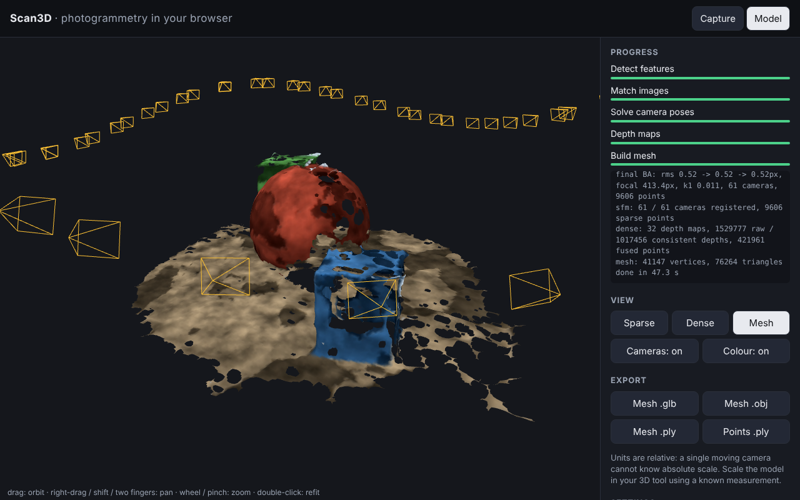

# Scan3D: photogrammetry in the browser

Scan3D does what RealityScan and Polycam do in photo mode: you walk around an object with your
phone's camera and get a coloured 3D mesh. Everything runs on your own device. The
reconstruction engine is written in Rust and compiled to WebAssembly, so there is no server
and frames never leave the browser.



## Use it

```bash
./build.sh                       # Rust -> web/pkg (prebuilt copy already committed)
cd web && python3 -m http.server 8000
# open http://localhost:8000
```

Browsers only allow camera access on **https** or **localhost**. The live app is hosted at
**https://scan3d.scan3d-app.workers.dev** (a Cloudflare Worker): open it in Safari on the iPhone.
Processing stays on the phone; nothing is uploaded. To redeploy after a change:
`./build.sh && python3 deploy/make_worker.py && cd deploy/build && npx wrangler@3.99.0 deploy`
(needs a Cloudflare API token with Workers edit rights).

1. **Capture**: press *Start camera* and tap the object on screen. Arrows over the live video
   tell you which way to walk. They come from the engine re-solving every camera position in
   the background as frames arrive. A coverage ring shows which sides are done; after the first
   lap it asks you to raise the phone and go round again looking down, and it says when coverage
   is complete. Frames are captured automatically when you have moved enough (the meter under
   the arrow) and the image is sharp. You can also *Import* photos or a video.
2. **Build 3D model**: the stages run in a Web Worker. The sparse cloud and camera frusta
   appear first, then the dense cloud, then the mesh.
3. **Export** as `.glb` (web, AR, Blender), `.obj` or `.ply` with vertex colours, or the dense
   point cloud as `.ply`.

Model units are relative, because one moving camera cannot measure absolute scale.

### Capture tips

- **Objects:** walk around the object in small steps (about 15–20°), then do a second lap from
  higher up. Plain or shiny objects (a single-colour cup, glazed ceramics) give little to
  match. Put them on a patterned surface such as a newspaper or a printed cloth, and keep some of
  it in every photo.
- **Buildings and streets:** point the camera sideways at the facades and walk along them.
  Filming straight ahead while walking forward is ambiguous for photo-only reconstruction (turning
  and side-stepping look alike) and drifts. When you turn around for the other side of the street,
  take a few photos looking along the street so the two sides connect.
- **Photos from a phone's camera app** carry the lens in their EXIF data, which the app reads.
  For the live camera and EXIF-less photos the lens is estimated from the photos. That fails for
  purely sideways motion past flat walls, where it falls back to the setting.
- If a scan fails, **Save scan photos (.zip)** packs the photos and the processing log.

## Pipeline (`core/src`)

| Stage | File | Method |
|---|---|---|
| Features | `features.rs` | Multi-scale FAST-9 corners, Harris ranking, grid bucketing, oriented BRIEF 256-bit descriptors |
| Matching | `features.rs`, `pipeline.rs` | Mutual nearest neighbours with ratio test; neighbouring frames plus a long-range skeleton for loop closure; fundamental-matrix RANSAC |
| Poses | `sfm.rs`, `geometry.rs` | Consistent track building. The two-view start comes from the essential matrix or homography decomposition, scored by truncated reprojection cost and refined. Several starts are grown and the one most consistent with all pair matches is kept. Registration uses P3P-RANSAC, with a two-view fallback. The lens is held fixed and found by a field-of-view search when it isn't in EXIF |
| Refinement | `ba.rs` | Levenberg–Marquardt bundle adjustment with Schur complement and Huber loss. Self-calibrates focal length and radial distortion |
| Dense | `mvs.rs` | Per-view plane-sweep stereo (ZNCC, inverse-depth sampling, sub-sample refinement), cross-view geometric consistency filter, fused coloured cloud with normals |
| Mesh | `poisson.rs`, `mesh.rs` | Poisson surface reconstruction of the dense oriented points (coarse-to-fine conjugate gradients, Surface Nets). Object mode (cameras surround one point) closes gaps such as plain surfaces, and scene mode keeps surface near data. Surface lying in space the cameras saw through is trimmed. Vertex colours are visibility-weighted. TSDF fusion is still available (`mesh_tsdf`). |

`lib.rs` exposes a `Scanner` class to JavaScript via `wasm-bindgen`. The front end is
dependency-free JavaScript: `app.js` (capture and import), `worker.js`, `viewer.js` (WebGL2)
and `export.js`.

## Testing

`core/src/synth.rs` ray-traces a textured scene with known geometry and known cameras.
`core/src/scenes.rs` adds harder scenes with sensor noise and specular highlights: a glossy,
nearly plain cup (`cargo run --release --example scene -- cup`), a street walked forward
(`street`) and facades filmed sideways (`facades`).

```bash
cd core
cargo test --release                              # 40 views: poses, focal and mesh accuracy
cargo run --release --example synthetic 60        # prints accuracy and timing per stage
cargo run --release --example synthetic -- --y4m orbit.y4m 360   # fake-webcam video
```

The `.y4m` video can be fed to Chromium as a webcam
(`--use-fake-device-for-media-stream --use-file-for-fake-video-capture=orbit.y4m`), which tests
the whole browser flow headlessly. On that test (60 auto-captured frames at 480×360):

- All cameras register, and focal length self-calibrates to within about 1%.
- Camera centres are within 0.2% of the orbit radius.
- Median mesh error is about 0.2% of scene size.
- The whole run takes about 47 s in WASM in a single thread.

## Next steps

- Texture atlas (UV-mapped photo texture) instead of vertex colours.
- Parallel depth maps using several workers (WASM threads).
- Scale from a known reference (marker or user-entered distance), cropping and a ground plane.
- Use phone motion sensors or ARCore/ARKit poses as a prior when available.
